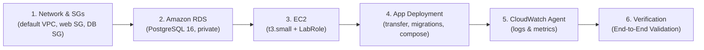

# MCPulse: Project Progress & AWS Cloud Deployment Guide

**Project:** MCPulse (MCP Server Monitoring & Performance Analytics Platform)  
**Academic Context:** MCA Semester III — Cloud Computing  
**Document Purpose:** A concise, step-by-step record of what has been implemented so far and the exact, actionable steps required for the full AWS cloud deployment.

> **Revision note (2026-10-21).** Every claim in this document was re-verified
> against the source code and the configuration files. Several statements in the
> previous revision did not match the code and have been corrected: the
> provider count is now five, the SSRF guard is now actually wired in, RDS TLS
> is now verified, and the Docker builds are now fixed. See
> `docs/DEPLOYMENT_STATUS.md` for the full list of corrections and the
> verification evidence.

---

## Part 1: What Has Been Done Till Now

### 1. Database & Persistence Layer
- **PostgreSQL Database Schema:**
  - `mcp_servers`: Monitored endpoint configurations, protocols, intervals, enabled/disabled states.
  - `monitoring_checks`: Check timestamps, latency (`duration_ms`), HTTP status codes, sanitized error categories, and outcomes.
  - `incidents`: Outage lifecycle tracking (open/resolved, start/end timestamps, triggering check reference).
  - `mcp_tools`: Discovered tool inventory, tool descriptions, input schemas, and metadata fingerprints.
  - `tool_test_profiles`: Custom test input configurations and expected validation rules.
  - `tool_monitoring_checks`: Tool execution latency, outcomes, and response-validation results.
  - `tool_incidents`: Tool-specific failure records.
- **Automated Migration Engine (`apps/api/src/db/migrate.ts`):** Transactional migration runner applying incremental SQL files from `apps/api/migrations/`.
- **RDS & Local Compatibility:** Database connection pool (`apps/api/src/db/pool.ts`) supports both local Docker PostgreSQL and AWS RDS. For an RDS endpoint the TLS chain is verified against the Amazon RDS CA bundle (`RDS_CA_BUNDLE_PATH`) with `rejectUnauthorized: true`, and the certificate hostname is checked. The connection string is stripped of every `ssl*` parameter first, because `pg` rebuilds the TLS options from the URL and would otherwise silently discard the verified configuration.

### 2. Monitoring Engine & Security Controls
- **Streamable HTTP & SSE Protocol Checker (`apps/api/src/monitoring/checker.ts`):**
  - Sends valid MCP JSON-RPC `initialize` handshake using protocol version `2025-03-26`.
  - Maintains `Mcp-Session-Id` session tracking across calls.
  - Handles both JSON responses and request-scoped Server-Sent Events (`text/event-stream`).
  - Measures true round-trip latency in milliseconds.
- **SSRF Protection (`apps/api/src/monitoring/ssrf.ts`):** Enforces endpoint destination validation. It rejects loopback (`127.0.0.1`, `::1`), private networks (`10.x`, `192.168.x`, `172.16.x`), carrier-grade NAT, link-local addresses (`169.254.0.0/16`, which covers the cloud metadata endpoint `169.254.169.254`), IPv6 unique-local and link-local addresses, and internal hostnames (`.internal`, `.local`, `localhost`). A DNS-aware variant (`validateResolvedDestination`) additionally resolves the hostname and rejects names that point at private addresses.
  - **The guard is applied in two places:** when a server is registered or updated, and immediately before every outbound request in the checker. Blocked endpoints are recorded with the distinct error code `SSRF_BLOCKED`.
- **Error Sanitization:** Strips authorization tokens, sensitive request/response payloads, and raw stack traces before storing them in the database or returning them via the API.

### 3. Background Scheduler & Incident Lifecycle
- **Scheduler (`apps/api/src/monitoring/scheduler.ts`):** Evaluates server configurations every 10 seconds via `node-cron`.
- **Overlap Prevention:** In-memory lock map ensures a slow check on a server never triggers a concurrent duplicate check.
- **Failure Threshold & Incidents:**
  - 1 or 2 failures mark the server as **Degraded**.
  - 3 consecutive failures mark the server as **Down** and automatically open an **Incident**.
  - The first successful check after an outage marks the server **Healthy** and automatically resolves the open incident.
- **Chaos Outage Simulator:** Endpoint `POST /api/servers/:id/simulate-outage` allowing controlled testing of outage detection and recovery workflows. It is an administrative route: it is reachable only from the administrator address (see Part 2, Step 1) and it can additionally require an admin key.

### 4. Tool Discovery & Diagnostics
- **Tool Discovery (`POST /api/servers/:id/discover-tools`):** Discovers all exposed MCP tools using `tools/list` and saves schemas to PostgreSQL.
- **Tool Testing (`POST /api/tools/:id/test`):** Safely triggers read-only `tools/call` with explicit input schemas and measures tool duration.
- **Evidence-Based Telemetry Diagnostics (`GET /api/analysis/:serverId`):** Evaluates recorded checks, separates verified facts from hypotheses, and suggests troubleshooting steps.
- **Monitored Providers (5, seeded by migration `003_seed_providers.sql`):** GitHub, Google Drive, Brave Search, Cloudflare and Hugging Face. The same five are the only quick-add presets in the dashboard. No other provider is registered automatically and no third-party MCP server is installed or self-hosted.

### 5. Frontend Dashboard (shadcn-inspired UI)
- **Theme Support:** Dark Theme and Off-White Light Theme with instantaneous toggle.
- **Live Observability:** Real-time uptime SLA badge, aggregate status counts (Healthy, Degraded, Down, Unknown, Disabled).
- **Dynamic Metrics Charting:** Recharts latency visualization that updates immediately when selecting any server row.
- **Tool Explorer:** Visual card hierarchy displaying tool names, descriptions, input schemas, and manual test triggers.
- **Telemetry CSV Export:** Direct browser download button (`GET /api/reports/export-csv`) fulfilling requirement FR-12.
- **Same-origin API calls:** The browser calls the API on its own origin (`/api/...`), which is reverse-proxied by nginx in production and by the Vite dev proxy in local development.

### 6. Production Deployment Preparation
- **Docker Multi-Stage Builds:** `apps/api/Dockerfile` (Node 20 Alpine) and `apps/web/Dockerfile` (Nginx Alpine). The project is an npm workspace, so the build context is the repository root and the install is workspace aware.
- **Reverse Proxy Config (`apps/web/nginx.conf.template`):** Nginx serves the React static build, reverse-proxies `/api/*` to Node.js on port 3001, streams the operational logs to the container stdout, and restricts every state changing API operation to the administrator address.
- **Production Compose:** `compose.aws.yaml` configured for container startup on Amazon EC2, with a database-backed readiness probe and the API port bound to loopback.
- **CloudWatch Unified Agent Config:** `docs/amazon-cloudwatch-agent.json` collects the host syslog and the Docker container logs plus memory and disk metrics.

---

## Part 2: AWS Deployment



### Step 0: Refresh the temporary Learner Lab credentials

The credentials expire and never renew automatically. Get them from the
Learner Lab page (academy.awsacademy.com → your course → the lab → **AWS
Credentials** panel → Copy credentials / Download .csv), then store them
**locally** — never through a chat or a script:

```bash
aws-lab-login     # prompts with hidden input, writes ~/.aws/credentials (600), verifies

# equivalent manual commands:
aws configure --profile learnerlab
aws configure set aws_session_token <SESSION_TOKEN> --profile learnerlab
aws sts get-caller-identity --profile learnerlab
```

If the last command fails with `InvalidClientTokenId` or `ExpiredToken`, the
session token is stale: end and restart the lab, then copy a fresh one. The
region shown in the Learner Lab console must match the region in
`~/.aws/config` (`aws configure set region <REGION> --profile learnerlab`).

### Step 1: Read-only audit, then network & security groups

```bash
scripts/aws/audit.sh
```

The audit reports the identity, the region, the default VPC, the existing
resources and the `LabRole` permissions without changing anything.

The deployment then creates two security groups in the **default VPC** (no
custom VPC, no NAT gateway, no load balancer):

- **`mcpulse-web-sg`** — inbound: HTTP 80 and HTTPS 443 from `0.0.0.0/0`,
  SSH 22 from `<your public IP>/32` only. Outbound: all traffic (required for
  the outbound MCP health checks).
- **`mcpulse-db-sg`** — inbound: PostgreSQL 5432 **from `mcpulse-web-sg` only**.
  The database is never exposed to the internet.

The administrator allowlist is baked into nginx (`MCPULSE_ADMIN_IP`) and
restricts every state changing API operation (register a server, manual check,
tool discovery, tool test, outage simulation, delete). Read-only operations and
the dashboard stay public. Because Docker's default bridge networking rewrites
the client address to the Docker gateway, nginx runs with **host networking**
so the allowlist sees the real client IP.

### Step 2: Provision Amazon RDS PostgreSQL

| Setting | Value |
| --- | --- |
| Engine | PostgreSQL 16 (16.13 in this region) |
| DB instance identifier | `mcpulse-db` |
| Class | `db.t3.micro` (Single-AZ) |
| Storage | 20 GB gp3, autoscaling disabled |
| Master user / database | `mcpulse_admin` / `mcpulse` |
| Connectivity | Default VPC, `mcpulse-db-sg` |
| **Public access** | **No** (private only) |
| Backup retention | 0 days (lab budget) |
| Deletion protection | Off (the lab is temporary) |

The endpoint of the deployed instance is
`mcpulse-db.cyinxjr3lgjz.us-east-1.rds.amazonaws.com:5432`. A custom DB
subnet group could **not** be created in this account ("Some input subnets are
invalid"), so the instance uses the default subnet group of the default VPC.
It stays private because public access is off and the database security group
only accepts port 5432 from the web security group.

The master password is generated locally by `scripts/aws/deploy.sh`, stored
with mode 600 in `~/.mcpulse/` (outside the repository) and written to the
instance `.env` (mode 600). It is never printed and never committed.

### Step 3: IAM role

The existing `LabRole` and its `LabInstanceProfile` exist, but the account
does not grant `iam:PassRole`, so no instance profile can be attached to the
instance and the instance runs without AWS credentials of its own.

The CloudWatch agent therefore uses the temporary Learner Lab credentials,
which the deployment script copies to `/root/.aws/credentials` (mode 600).
**Log and metric delivery stops when the lab session ends** and resumes after
the credentials are refreshed and the agent is restarted.

### Step 4: Launch Amazon EC2

| Setting | Value |
| --- | --- |
| Name | `mcpulse-server` |
| AMI | **Amazon Linux 2023** (`ami-0856027a77429315a`) — Ubuntu is not visible to this account |
| Instance type | `t3.small` (2 GB RAM — `t3.micro` is too small for the image build) |
| Network | Default VPC, public subnet, auto-assign public IP (not every AZ offers `t3.small`, the deployment tries each one) |
| Security group | `mcpulse-web-sg` |
| IAM instance profile | none — the account does not grant `iam:PassRole`, so no role can be attached |
| Key pair | `mcpulse-lab` (private key kept in `~/.mcpulse/`, mode 600) |
| Login user | `ec2-user` (Amazon Linux) |

### Step 5: Deploy MCPulse on EC2

The project is not a Git repository, so the sources are transferred with `tar`
over SSH. On the instance:

```bash
cd /home/ubuntu/mcpulse

# Production configuration (mode 600, secrets stay on the instance)
cat > .env <<'ENV'
NODE_ENV=production
PORT=3001
HOST=0.0.0.0
CORS_ORIGIN=http://<EC2-PUBLIC-IP>
DATABASE_URL=postgresql://<user>:<password>@<RDS-ENDPOINT>:5432/mcpulse
CHECK_TIMEOUT_MS=10000
INCIDENT_FAILURE_THRESHOLD=3
RDS_CA_BUNDLE_PATH=/etc/ssl/certs/rds-ca-global-bundle.pem
MCPULSE_ADMIN_IP=<your public IP>
ENV
chmod 600 .env

# Amazon RDS CA bundle for the verified TLS connection
mkdir -p certs
curl -fsSL https://truststore.pki.rds.amazonaws.com/global/global-bundle.pem \
  -o certs/rds-ca-global-bundle.pem

# Migrations (applies 001, 002 and the five provider seeds)
docker compose -f compose.aws.yaml run --rm --no-deps api node apps/api/dist/db/migrate.js

# Start the services
docker compose -f compose.aws.yaml up -d --build
```

`scripts/aws/deploy.sh` performs exactly these steps and is safe to re-run.

### Step 6: Install & start the Amazon CloudWatch Unified Agent

Only when the instance profile grants the required permissions:

```bash
sudo wget https://s3.amazonaws.com/amazoncloudwatch-agent/ubuntu/amd64/latest/amazon-cloudwatch-agent.deb
sudo dpkg -i -E ./amazon-cloudwatch-agent.deb
sudo cp /home/ubuntu/mcpulse/docs/amazon-cloudwatch-agent.json \
  /opt/aws/amazon-cloudwatch-agent/etc/amazon-cloudwatch-agent.json
sudo /opt/aws/amazon-cloudwatch-agent/bin/amazon-cloudwatch-agent-ctl \
  -a fetch-config -m ec2 -s -c file:/opt/aws/amazon-cloudwatch-agent/etc/amazon-cloudwatch-agent.json
sudo /opt/aws/amazon-cloudwatch-agent/bin/amazon-cloudwatch-agent-ctl -m ec2 -a status
```

Expected log groups: `/mcpulse/app/containers` (the API and nginx container
logs), `/mcpulse/ec2/messages` and `/mcpulse/ec2/secure` (Amazon Linux 2023
writes to `/var/log/messages` and `/var/log/secure`, not `/var/log/syslog`).

### Step 7: End-to-End Cloud Validation

1. **Dashboard Access:** open `http://<EC2-PUBLIC-IP>`, verify the dashboard
   renders and the theme toggle works.
2. **Database Verification:** `GET /api/dashboard/summary` lists the five
   providers loaded from Amazon RDS.
3. **Live Health Checks:** the latency chart and the check timestamps update
   every 60 seconds with the real round-trip latency.
4. **Tool Discovery:** "Discover Tools" on Hugging Face returns the live tool
   catalogue (`hf_fs`, `hf_whoami`, `hub_repo_details`, `hub_repo_search`).
5. **Simulated Outage & Incident Handling:** `POST /api/servers/<id>/simulate-outage`
   (from the administrator address) — the server moves Healthy → Degraded →
   Down, an incident opens after three consecutive failures, and the incident
   resolves automatically when the outage is cleared.
6. **Telemetry Report Download:** "Export CSV" downloads the check history.
7. **Health diagnostics:** `GET /health` (liveness) and `GET /health/ready`
   (database connectivity) both answer on the instance and through nginx.

### Step 8: Cost Management & Lab Shutdown Protocol

Learner Lab accounts have a strict credit limit and a session timer. Stop the
resources whenever they are not being used:

```bash
scripts/aws/stop.sh            # asks for confirmation, stops EC2 and RDS
scripts/aws/stop.sh --dry-run  # shows the consequences without changing anything
```

Nothing is deleted: the database keeps its data, the migration history and the
schema, and the instance keeps its volume. To bring everything back after a
session restart:

```bash
scripts/aws/resume.sh
```

The resume workflow verifies the identity, discovers the current state, starts
the database first and waits for it, then starts the instance and verifies the
containers and the endpoint. It never recreates infrastructure.

---

## Part 3: Repeatable Workflows

| Command | Purpose |
| --- | --- |
| `scripts/aws/audit.sh` | Read-only readiness inspection |
| `scripts/aws/deploy.sh` | Create or update the environment and the application |
| `scripts/aws/resume.sh` | Resume an existing deployment after a lab restart |
| `scripts/aws/stop.sh` | Stop the resources to reduce cost (asks first) |

The same workflows are available as OpenCode commands in
`.opencode/commands/`: `/aws-audit`, `/aws-deploy`, `/aws-resume`, `/aws-stop`.

## Part 4: Cost Estimate

| Resource | On-demand rate (us-east-1) |
| --- | --- |
| EC2 `t3.small` | ≈ $0.021 / hour |
| RDS `db.t3.micro` (Single-AZ) | ≈ $0.017 / hour |
| RDS storage 20 GB gp3 | ≈ $2.30 / month |
| Public IPv4 address | ≈ $0.005 / hour |
| CloudWatch agent, logs, metrics | no charge for the agent itself |

A four hour lab session is roughly **$0.18**. Leaving everything running for a
full month is roughly **$33**, which is why the stop workflow exists. No load
balancer, NAT gateway, Multi-AZ deployment or S3 bucket is used.
