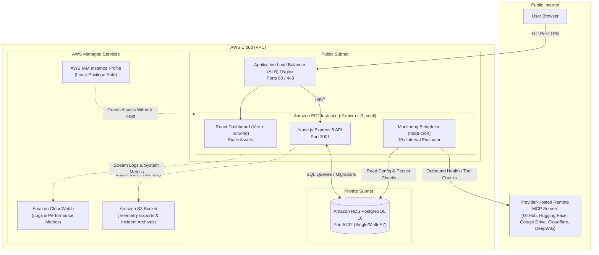

# MCPulse — Full AWS Cloud Deployment Plan

**Project:** MCPulse (MCP Server Monitoring & Performance Analytics Platform)  
**Academic Context:** MCA Semester III — Cloud Computing  
**Document Reference:** [MCPulse_Project_Specification.md](file:///Users/prathammevada/Documents/Pratham/MCA/Sem3/CC/Project/docs/MCPulse_Project_Specification.md) & [NEW_MCPulse_Project_Proposal_Cloud_Computing.docx](file:///Users/prathammevada/Documents/Pratham/MCA/Sem3/CC/Project/docs/NEW_MCPulse_Project_Proposal_Cloud_Computing.docx)  
**Deployment Target:** Amazon Web Services (AWS)

---

## 1. Executive Summary & Architecture Overview

MCPulse is an observability platform for Model Context Protocol (MCP) servers. The architecture is deployed fully on AWS infrastructure as a service (IaaS) and managed platform services, demonstrating cloud networking, security isolation, relational data persistence, compute scheduling, object storage, and operational telemetry.

### AWS Cloud Architecture Diagram



---

## 2. AWS Services Inventory & Responsibility Matrix

| AWS Service | Category | Specific Role in MCPulse | Configuration / Sizing |
| :--- | :--- | :--- | :--- |
| **Amazon EC2** | Compute | Hosts frontend reverse proxy, Node.js Express API, and the periodic MCP monitoring scheduler. | `t2.micro` or `t3.small` (Ubuntu 22.04 LTS / Amazon Linux 2023) |
| **Amazon RDS** | Database | Persists registered servers, health check results, duration/latency, tool discovery schemas, test profiles, and incident histories. | PostgreSQL 16, `db.t3.micro` or `db.t4g.micro`, 20 GB gp3 storage |
| **Amazon VPC** | Networking | Provides network isolation with dedicated public and private subnets, route tables, and Internet Gateway. | 1 VPC (`10.0.0.0/16`), 2 Public Subnets, 2 Private Subnets |
| **Security Groups** | Security / Firewall | Implements strict ingress/egress rules enforcing least-privilege traffic flows. | `mcpulse-web-sg` (80, 443, 22), `mcpulse-db-sg` (5432 from web-sg only) |
| **AWS IAM** | Identity & Access | Provides instance credentials for EC2 to write to CloudWatch and upload reports to S3 without stored keys. | EC2 Instance Role with `CloudWatchAgentServerPolicy` and scoped S3 access |
| **Amazon CloudWatch** | Observability | Aggregates application logs, scheduler execution telemetry, and host CPU/memory utilization alarms. | Log Group: `/aws/ec2/mcpulse-production`, Alarms for high CPU / check failures |
| **Amazon S3** | Object Storage | Stores scheduled/on-demand CSV exports of check history, telemetry dumps, and incident post-mortems (Spec FR-12). | Bucket: `mcpulse-telemetry-reports-<account-id>` (Private, SSE-S3 encryption) |
| **Application Load Balancer (ALB)** | Load Balancing | Distributes external traffic to EC2 and terminates SSL/TLS (or handled via Nginx on EC2). | Internet-facing ALB with Target Group routing to port 80/3001 |
| **Auto Scaling** | Elasticity | Maintains high availability and replaces unhealthy EC2 instances automatically. | Desired: 1, Min: 1, Max: 2 with CloudWatch health check triggers |

---

## 3. Network Architecture & Security Groups Specification

### 3.1 VPC Subnet Layout
- **VPC CIDR:** `10.0.0.0/16`
- **Public Subnet 1 (us-east-1a):** `10.0.1.0/24` — EC2 instance, ALB, Internet Gateway route (`0.0.0.0/0 -> igw`).
- **Public Subnet 2 (us-east-1b):** `10.0.2.0/24` — Secondary AZ for ALB requirement.
- **Private Subnet 1 (us-east-1a):** `10.0.10.0/24` — RDS PostgreSQL Primary.
- **Private Subnet 2 (us-east-1b):** `10.0.11.0/24` — RDS PostgreSQL Standby / DB Subnet Group.

### 3.2 Security Group Rules (Strict Least Privilege)

#### `mcpulse-web-sg` (Attached to EC2 / ALB)
- **Inbound Rules:**
  - HTTP (TCP 80): `0.0.0.0/0` (Allow public access to web dashboard)
  - HTTPS (TCP 443): `0.0.0.0/0` (Secure web traffic)
  - SSH (TCP 22): `<Your-Admin-IP>/32` (Strictly restricted to developer IP, never 0.0.0.0/0)
- **Outbound Rules:**
  - HTTPS (TCP 443): `0.0.0.0/0` (Required for scheduler to run outbound health checks against remote MCP endpoints)
  - PostgreSQL (TCP 5432): Destination `mcpulse-db-sg` (Private access to RDS)

#### `mcpulse-db-sg` (Attached to RDS PostgreSQL)
- **Inbound Rules:**
  - PostgreSQL (TCP 5432): Source `mcpulse-web-sg` (EC2 security group ID). **Never exposed to 0.0.0.0/0**.
- **Outbound Rules:**
  - None (All outbound traffic blocked for maximum security).

---

## 4. Phase-by-Phase AWS Deployment Execution Plan

### Step 1: Network & Security Group Provisioning
1. Use existing default VPC or create a dedicated VPC (`10.0.0.0/16`) with an Internet Gateway.
2. Create DB Subnet Group spanning at least two Availability Zones (e.g., `us-east-1a` and `us-east-1b`).
3. Create `mcpulse-web-sg` and `mcpulse-db-sg` as specified above.

### Step 2: Amazon RDS PostgreSQL Provisioning
1. Launch Amazon RDS PostgreSQL instance:
   - **Engine:** PostgreSQL 16.x
   - **Template:** Free Tier / Dev/Test
   - **DB Instance Identifier:** `mcpulse-db`
   - **Instance Class:** `db.t3.micro` or `db.t4g.micro`
   - **Storage:** 20 GB gp3, General Purpose SSD (Storage Auto-scaling disabled to control cost)
   - **Connectivity:** VPC Subnet Group, Public Access = **No**
   - **VPC Security Group:** Select `mcpulse-db-sg`
   - **Database Name:** `mcpulse`
   - **Master Username:** `mcpulse_admin`
   - **Master Password:** Strong generated password stored securely
2. Note the RDS endpoint once provisioning completes: `mcpulse-db.<account-id>.<region>.rds.amazonaws.com`.

### Step 3: Amazon S3 Bucket & IAM Role Setup
1. Create S3 Bucket for exports:
   - **Name:** `mcpulse-telemetry-reports-<account-id>`
   - **Block all public access:** Enabled
   - **Encryption:** Server-side encryption (SSE-S3)
2. Create IAM Role for EC2 (`mcpulse-ec2-role`):
   - Attach AWS Managed Policy: `CloudWatchAgentServerPolicy`
   - Attach Inline S3 Policy:
     ```json
     {
       "Version": "2012-10-17",
       "Statement": [
         {
           "Effect": "Allow",
           "Action": ["s3:PutObject", "s3:GetObject", "s3:ListBucket"],
           "Resource": [
             "arn:aws:s3:::mcpulse-telemetry-reports-*",
             "arn:aws:s3:::mcpulse-telemetry-reports-*/*"
           ]
         }
       ]
     }
     ```
3. Attach IAM Role to EC2 Instance Profile.

### Step 4: Amazon EC2 Provisioning & Initial Setup
1. Launch EC2 instance:
   - **AMI:** Ubuntu 22.04 LTS (64-bit x86)
   - **Instance Type:** `t2.micro` or `t3.small`
   - **Key Pair:** Select or generate an RSA key pair (`mcpulse-key.pem`)
   - **Network:** Select VPC, Public Subnet, Auto-assign Public IP = **Enable**
   - **Security Group:** Select `mcpulse-web-sg`
   - **IAM Instance Profile:** Select `mcpulse-ec2-role`
2. Connect to EC2 instance via SSH:
   ```bash
   chmod 400 mcpulse-key.pem
   ssh -i mcpulse-key.pem ubuntu@<EC2-PUBLIC-IP>
   ```
3. Install Docker, Docker Compose, and Node.js on EC2:
   ```bash
   sudo apt-get update && sudo apt-get upgrade -y
   sudo apt-get install -y ca-certificates curl gnupg lsb-release
   # Install Docker
   curl -fsSL https://get.docker.com | sudo sh
   sudo usermod -aG docker ubuntu
   # Install Node.js 20 & Git
   curl -fsSL https://deb.nodesource.com/setup_20.x | sudo -E bash -
   sudo apt-get install -y nodejs git
   ```

### Step 5: Application Deployment & Migration
1. Clone project repository to `/home/ubuntu/mcpulse`:
   ```bash
   git clone <repo-url> /home/ubuntu/mcpulse
   cd /home/ubuntu/mcpulse
   ```
2. Configure production `.env` pointing to AWS RDS and S3:
   ```env
   NODE_ENV=production
   PORT=3001
   HOST=0.0.0.0
   CORS_ORIGIN=http://<EC2-PUBLIC-IP>
   DATABASE_URL=postgresql://mcpulse_admin:<PASSWORD>@<RDS-ENDPOINT>:5432/mcpulse?sslmode=require
   CHECK_TIMEOUT_MS=10000
   INCIDENT_FAILURE_THRESHOLD=3
   S3_BUCKET_NAME=mcpulse-telemetry-reports-<account-id>
   AWS_REGION=us-east-1
   ```
3. Run Database Migrations against Amazon RDS:
   ```bash
   npm --prefix apps/api run build
   npx --prefix apps/api tsx apps/api/src/db/migrate.ts
   ```
4. Build Web Frontend:
   ```bash
   npm --prefix apps/web run build
   ```
5. Run application containers via Docker Compose or systemd service.

### Step 6: Amazon CloudWatch Unified Agent Setup
1. Install CloudWatch agent on EC2:
   ```bash
   sudo wget https://s3.amazonaws.com/amazoncloudwatch-agent/ubuntu/amd64/latest/amazon-cloudwatch-agent.deb
   sudo dpkg -i -E ./amazon-cloudwatch-agent.deb
   ```
2. Configure CloudWatch to stream Node.js logs and monitor EC2 memory/disk:
   - Log group: `/mcpulse/application`
   - Metrics: CPU Utilization, Memory % Used, Disk % Used.
3. Start the agent:
   ```bash
   sudo /opt/aws/amazon-cloudwatch-agent/bin/amazon-cloudwatch-agent-ctl \
     -a fetch-config -m ec2 -s -c file:/opt/aws/amazon-cloudwatch-agent/bin/config.json
   ```

---

## 5. Verification & Testing Gate on AWS

Once deployed on AWS, perform the following validation steps to confirm complete functionality:
1. **Public Dashboard Access:** Navigate to `http://<EC2-PUBLIC-IP>` in a browser; verify that the shadcn dark/off-white dashboard renders smoothly.
2. **Database Persistence:** Verify that the 8 registered MCP servers are loaded from Amazon RDS PostgreSQL.
3. **Outbound Health Checks:** Verify that the scheduler on EC2 sends HTTP/SSE health checks to remote endpoints (DeepWiki, Hugging Face, etc.) and records latency into RDS.
4. **Tool Discovery & Testing:** Trigger tool discovery and test execution from the dashboard; confirm results persist in RDS.
5. **Simulated Outage & Recovery:** Trigger chaos outage simulator on a server; verify consecutive failures generate an incident in RDS and resolve upon recovery.
6. **CloudWatch Metrics:** In the AWS Console, check CloudWatch Logs and Metrics to confirm logs and CPU/memory metrics are streaming.
7. **S3 Telemetry Export:** Trigger CSV export and verify the archive is stored in the S3 bucket.

---

## 6. Learner Lab Considerations & Cost Control

- **Budget Cap:** Learner Lab accounts operate under strict credit caps ($100 or less).
- **Auto-Stop Policy:** AWS Learner Lab instances stop when sessions expire. The deployment plan uses standard Docker/systemd startup scripts so the platform boots automatically upon instance start.
- **Teardown Protocol:** Always stop the EC2 instance and RDS instance when not actively testing or presenting to prevent credit exhaustion.
